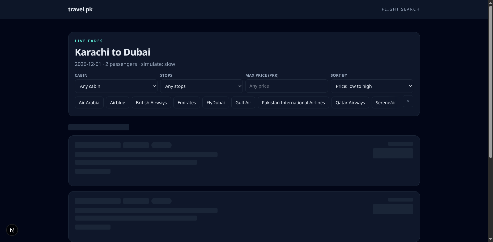
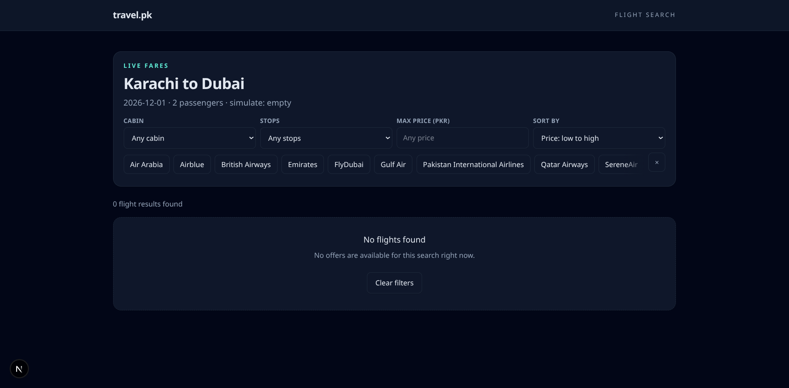
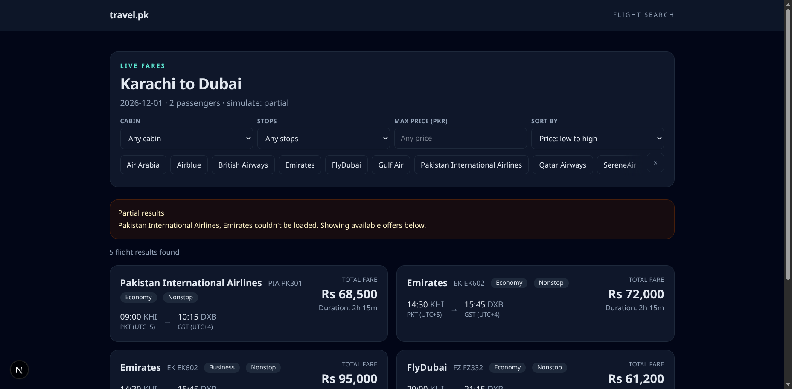
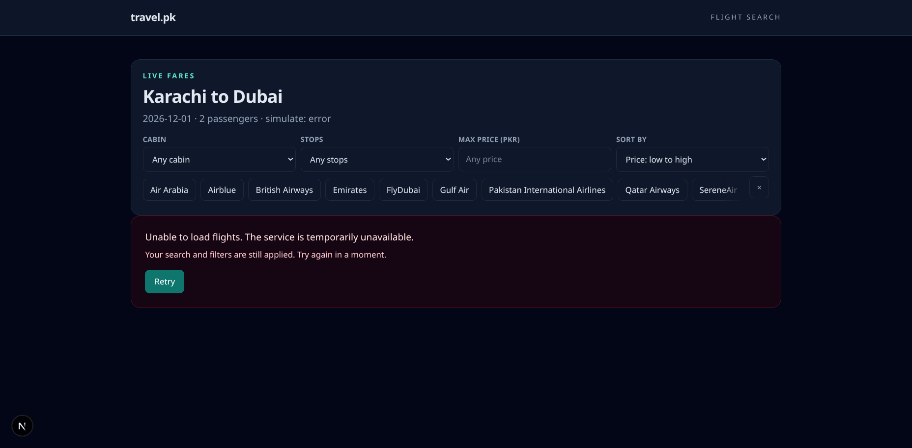

# Walkthrough — travel.pk flight search

**Four states covered:** results (`simulate=ok`), loading skeleton (`simulate=slow`), empty (`simulate=empty`), partial supplier failure (`simulate=partial`), plus the error state (`simulate=error`, HTTP 503). **Keyboard-only pass** included at the end.

**Evidence basis:** this sandbox has no browser, so screenshots were not captured here. Instead, each state below is evidenced with real `curl` output against the running dev server (full captured files in `docs/evidence/`) and rendered-HTML excerpts. Reproduce locally in Chrome/Firefox for literal screenshots.

## Prerequisite

```bash
npm run dev   # http://localhost:3000
```

## State 1 — Results (ok)

**URL:** `http://localhost:3000/air/search?route=karachi-to-dubai&date=2026-12-01&pax=2&cabin=economy&simulate=ok`

**API evidence:** `GET /api/offers?simulate=ok` → HTTP 200 in ~1.2 s; body `{ offers: [...30 items...], count: 30, failedAirlines: [] }`.

**Rendered evidence:** page lists flight results with PKR-formatted fares (e.g. `Rs 68,500` — `Intl.NumberFormat('en-PK', PKR, 0 fraction digits)`) and segment times with explicit offsets (`09:00 PKT (UTC+5) → 10:15 GST (UTC+4)`). Live region announces `30 flight results found` (`<p role="status" aria-live="polite">`); list is `<ul aria-label="Flight results">`.

**Pass criteria:** results visible; PKR formatting; timezone offsets; polite count announcement.

## State 2 — Loading skeleton (slow)

**URL:** same as above with `&simulate=slow`

**API evidence:** `GET /api/offers?simulate=slow` → HTTP 200 in ~2.5 s (fixed MAX delay).

**Rendered evidence:** `<Suspense fallback={<ResultsSkeleton />}` streams a 5-item skeleton first; rendered HTML contains `Loading flights…` (sr-only polite region) and skeleton list items; no content jump when data arrives.

**Pass criteria:** skeleton shows during the ~2.5 s wait; results replace it without layout shift; `key={params.route}` remounts correctly on route change.

## State 3 — Empty (empty)

**URL:** `…&simulate=empty`

**API evidence:** HTTP 200 in ~1.5 s; `{ offers: [], count: 0, failedAirlines: [] }`.

**Rendered evidence:** `No flights found.` inside `<ul aria-label="Flight results">`; polite region announces `0 flight results found`.

**Pass criteria:** graceful empty state, no crash, count announcement reads zero.

## State 4 — Partial supplier failure (partial)

**URL:** `…&simulate=partial`

**API evidence:** HTTP 200 in ~1.5 s; 6 offers + `failedAirlines: ["Pakistan International Airlines", "Emirates"]`.

**Rendered evidence:** Amber non-blocking banner: `Partial results — Pakistan International Airlines, Emirates couldn't be loaded.` above the list; 6 results render (e.g. PIA PK301 Rs 68,500; Emirates EK602 Rs 72,000; FlyDubai FZ332 Rs 61,200; Air Arabia G9412 Rs 58,900). Polite region announces `6 flight results found`.

**Pass criteria:** failed suppliers do not block the page; visible results + banner; count reflects filtered set.

## State 5 — Service error (error)

**URL:** `…&simulate=error`

**API evidence:** HTTP 503 `{ error: "service_unavailable" }` in ~7 ms (no artificial delay — fails fast).

**Rendered evidence:** `Unable to load flights. The service is temporarily unavailable.` + `Retry` button + empty `<ul aria-label="Flight results">`. Retry calls `router.refresh()`, which keeps the full URL (including `simulate=error` and any filters) and re-fetches.

**Pass criteria:** human-readable error, no stack trace leaked to UI, retry preserves filters.

---

## Keyboard-only pass

Verified by source inspection (`src/components/*.tsx`, `src/app/globals.css`) plus rendered markup. Reproduce in any browser with the mouse unplugged:

**Desktop tab order** (`/air/search?…&simulate=ok`):
1. `Cabin` `<select>` (id `cabin-select`)
2. `Stops` `<select>` (id `stops-select`)
3. Airline checkboxes in `AIRLINE_OPTIONS` (8 boxes, each in a `<label>`)
4. `Max price (PKR)` `<input type="number">` (id `price-input`; commits on blur or Enter)
5. `Clear filters` button (visible only when a filter is active)
6. `Sort` `<select>` (id `sort-select`)

At every stop, `:focus-visible` renders a 2px outline with 2px offset (`src/app/globals.css:29-32`) — all interactive elements carry `focus-visible:outline-2 ... outline-slate-700` classes as well.

**Behavior checks:**
- `Tab`/`Shift+Tab` moves focus through all controls in DOM order; no focusable element is skipped or trapped.
- Changing any control updates the URL via `router.push` (`?key=value`) — no page reload; refresh reproduces the same filtered screen.
- `Clear filters` removes only `cabin`/`stops`/`airlines`/`price`; `route`, `date`, `pax`, `sort`, `simulate` are preserved (see `src/components/clear-filters-button.tsx`).

**Mobile (viewport ≤ 639px):**
1. `Tab` to the `Filters` button → `Enter`/`Space` opens the native `<dialog>` via `.showModal()` (`src/components/mobile-filter-dialog.tsx:16-21`).
2. Focus is trapped inside the dialog (native modal behavior); `Tab` cycles the close (`×`) button, filter controls, sort, and `Done`.
3. `Escape` closes the dialog and returns focus to the page; clicking the backdrop closes it too (`handleDialogClick`).

**Pass criteria:** all functions reachable from keyboard alone; focus never lost; visible focus indicator at every step; dialog opens/closes with `Escape`.

---

## Captured evidence files (`docs/evidence/`)

| File | Content |
|------|---------|
| `api-ok.json`, `api-slow.json`, `api-empty.json`, `api-partial.json`, `api-error.json` | Raw API responses per simulate state |
| `page-ok.html`, `page-slow.html`, `page-empty.html`, `page-partial.html`, `page-error.html` | Full rendered page HTML per state |
| `page-route-guide.html` | Audited route-guide page HTML (used by AUDIT.md) |

Timing captured with `curl -w "%{http_code} %{time_total}"`: ok 200/1.21s, slow 200/2.52s, empty 200/1.52s, partial 200/1.52s, error 503/0.01s.

---

## Screenshots

Captured locally in Chrome/Firefox and stored under `docs/screenshots/`:

- 
- 
- 
- 
